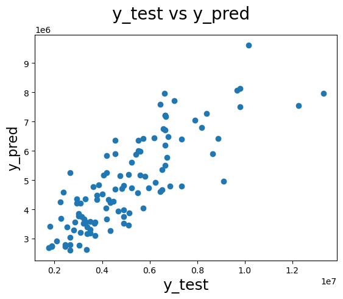

# House Price Prediction with Linear Regression

I built a linear regression model to predict house prices from 545 listings, using features like area, bathrooms and air conditioning. It scored an R² of 0.65 on the test set. The typical error is still about 1.3 million against an average price of 4.8 million, so I'd treat it as a rough guide, not a valuation tool. I only used one train/test split, so I'd cross-validate next. The dataset isn't in this repo.

